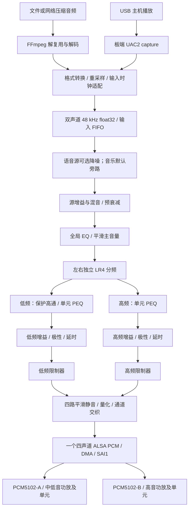

# RK3506 + 双 PCM5102 主动二分频与完整音频处理技术路线

更新日期：2026-10-21。

本文对应本目录的 `dp-rk3506g-mini.dts`。仓库实际目录名为 `alsa_digital distributor`，中间是空格。本文是源码核对后的设计路线：**已核对本地代码及官方资料，尚未实现双 DAC 播放程序、编译设备树、部署镜像或完成板端及声学测试。**

## 1. 目标与推荐方案

推荐实现立体声主动二分频：RK3506 把原始左右声道分别分成低、高两段，PCM5102-A 输出左低频、右低频，PCM5102-B 输出左高频、右高频。这里的 A/B 是两块模块的编号；本地驱动使用 `ti,pcm5102a`，实际芯片是否为 PCM5102 或 PCM5102A，实施前应核对丝印和对应手册。

**分频、EQ、延时、限幅和可选降噪在用户态 `audio_engine` 中完成，位置在 `snd_pcm_writei()` 之前。PCM5102 负责把已经处理好的数字信号转换成模拟信号。** DAC 自带的插值滤波模式不承担扬声器高低频分频；也不能把两块模块接到同一根 DIN 后，期待它们自动选择不同频段。[TI PCM5102A 数据手册，9.3 节](https://www.ti.com/lit/ds/symlink/pcm5102a.pdf)

本项目优先路线为：

```text
文件 / 网络 / USB 音频
        ↓
统一的双声道 48 kHz float32 PCM
        ↓
必要的输入处理 → 全局 EQ → 音量
        ↓
左右各一组 LR4 二分频
        ↓
四路独立单元校正、增益、极性、延时、保护
        ↓
一个四声道 ALSA playback PCM
        ↓
SAI1：共同 BCLK/LRCK，SDO0 与 SDO1 两根数据线
        ├─ SDO0 → PCM5102-A → 双声道功放 → 左低音、右低音
        └─ SDO1 → PCM5102-B → 双声道功放 → 左高音、右高音
```

在二分频系统中，本文的“低音”通常指承担低频和中频的中低音单元，而不是只播放几十 Hz 的超低音。分频点以下由它覆盖，以上由高音单元覆盖，不能留下没有单元承担的中频区间。

| DSP / ALSA 逻辑通道 | 目标数据线 | DAC 模拟输出 | 功放及单元 |
| --- | --- | --- | --- |
| 0：L_low | SAI1 SDO0 左槽 | A.OUTL | 左中低音 |
| 1：R_low | SAI1 SDO0 右槽 | A.OUTR | 右中低音 |
| 2：L_high | SAI1 SDO1 左槽 | B.OUTL | 左高音 |
| 3：R_high | SAI1 SDO1 右槽 | B.OUTR | 右高音 |

上表是**软件目标映射**，需通过四路逐一送信号核验 DMA/FIFO 到实际引脚的顺序。立体声二分频需要四路独立功放输出和四个对应单元；DAC 的线路输出接功放输入，不能直接驱动普通低阻扬声器。只有两只单元时，可以先做单声道二分频，使用 `M = 0.5 × (L + R)` 下混，但不再保留完整的左右立体声。

音质改善来自单元在适合的频段工作、分频区幅相衔接、合理声学布局及保护。增加 DAC 数量本身不能保证音质改善。

## 2. 本地源码现状与需要补齐的部分

### 2.1 当前目录并未配置双 DAC

本目录目前的 DTS 只有一个 `pcm5102`、一个 `sai0_sound`，使用 `simple-audio-card` 连接 `sai0`；参数是 I2S、CPU 提供位时钟及帧时钟、`mclk-fs = <256>`。引脚是：

| 当前信号 | pinctrl 标签 | 作用 |
| --- | --- | --- |
| MCLK | `rm_io8_sai0_mclk` | DAC SCK，是否使用取决于模块接法 |
| BCLK | `rm_io9_sai0_sclk` | 串行位时钟 |
| DIN | `rm_io10_sai0_sdo` | 一路立体声 I2S 数据 |
| LRCK | `rm_io11_sai0_lrck` | 左右声道帧时钟 |

DTS 部分注释仍提到 MAX98357A，实际 `compatible` 已是 PCM5102A；判断配置应以有效属性为准。本文不修改这个现有 DTS。

### 2.2 为什么推荐从 SAI0 转到 SAI1

本地 `arch/arm/boot/dts/rk3502.dtsi` 和 `rk3506-pinctrl.dtsi` 表明：

- SAI0 提供一根 `sdo`，以及 `sdi0～sdi3`。接收数据线不能直接当成第二根独立发送线。
- SAI1 提供 `sdo0～sdo3`，适合两根发送线、共同帧时钟的四声道输出。
- `sound/soc/rockchip/rockchip_sai.c` 的 `rockchip_sai_lanes_auto()` 在非 TDM 模式下按 `ceil(channels / 2)` 选择 lane。四声道对应两条 lane，每条传两个声道。
- `rockchip_sai_hw_params()` 按每条 lane 的声道数配置帧长与 BCLK，而不是把所有四声道塞进一根标准 I2S 线。

这是“同一 SAI、多条 I2S 数据线”的设计。不要把它误写成“两颗 PCM5102 共用一根四槽 TDM 数据线”：PCM5102A 的接口是双声道 I2S/LJ，没有本方案需要的任意 TDM 槽选择功能。

### 2.3 ASoC 应如何表示两颗 DAC

每颗 `pcm5102a.c` 的 DAI 声道能力都是 2。现有的单 Codec 声卡不能仅靠把应用 `OUTPUT_CHANNELS` 改成 4 就完成扩展。

优先复用本树的 `rockchip,multicodecs-card`：一个 SAI1 CPU DAI 连接两个 PCM5102 Codec DAI，对应用呈现一个四声道播放流。依据如下：

| 源码位置 | 已确认的职责 |
| --- | --- |
| `sound/soc/codecs/pcm5102a.c:15` | 注册双声道播放 DAI，支持 S16_LE、S24_LE、S32_LE；没有项目所需的 EQ/分频寄存器控制 |
| `sound/soc/rockchip/rockchip_multicodecs.c:792` | 解析多个 `rockchip,codec`，构成同一 DAI link 的多个 Codec |
| `sound/soc/rockchip/rockchip_multicodecs.c:368` | `hw_params` 设置 CPU/Codec 系统时钟，容许 Codec 不实现该操作 |
| `sound/soc/soc-pcm.c:635` | 多 Codec 场景使用 CPU DAI 的声道范围，后续再处理各 Codec 参数 |
| `sound/soc/rockchip/rockchip_sai.c:536` | 非 TDM 模式按双声道分配 lane |
| `sound/soc/rockchip/rockchip_sai.c:548` | 配置有效位宽、lane 数、每 lane 帧长、时钟分频 |

上述代码支持把该方案作为首选验证路径，**不等于已经证明此板四声道数据分配正确**。应用先固定请求四声道；后续如需在驱动层限制只接受 48 kHz/四声道，可在板级 Machine 路径加约束。不要把单颗 PCM5102 的 `channels_max` 强行改成 4 来伪装硬件能力。

本次读取到工作区 `.config` 中：SAI、MULTICODECS、SIMPLE_CARD 已启用，`CONFIG_SND_SOC_PCM5102A` 尚未启用。它只说明本地配置文件状态，不能据此判断当前板子所运行镜像的配置。

## 3. 硬件连接与设备树实施路线

### 3.1 同一时钟域、两根独立数据线

```text
RK3506 SAI1               PCM5102-A               PCM5102-B
  BCLK -------------------- BCK -------------------- BCK
  LRCK -------------------- LCK -------------------- LCK
  SDO0 -------------------- DIN
  SDO1 -------------------------------------------- DIN
  GND --------------------- GND -------------------- GND
  MCLK（若使用）------------ SCK -------------------- SCK
```

两颗 DAC 的音频格式、插值滤波模式、去加重设置应一致。对于 PCM5102A，FMT 低电平选择 I2S；48 kHz 路线关闭 44.1 kHz 去加重；FLT 两颗设成相同模式；XSMT 用于软静音。芯片内部滤波延迟不同也会影响高低音的相位衔接。[TI 数据手册，7、9.3.3、9.3.5 节](https://www.ti.com/lit/ds/symlink/pcm5102a.pdf)

时钟初始目标：

```text
Fs = LRCK = 48,000 Hz
每条数据线 = 2 个声道 × 32 bit 槽宽
BCLK = 48,000 × 2 × 32 = 3.072 MHz
如果使用 256 Fs 外部 MCLK：MCLK = 12.288 MHz
```

两条数据线并行，因此 BCLK 不需要再乘以两颗 DAC 的数量。两颗 DAC 即使共用 BCLK/LRCK，仍需检查上电、静音释放及反复启动后的模拟相对延迟是否稳定。

### 3.2 三线 I2S 与外部 MCLK 的选择

PCM5102A 支持由 BCLK 经内部 PLL 获得系统时钟；三线模式要求按手册处理 SCK，不能悬空。48 kHz、64 Fs BCLK 属于其支持组合。若实际模块允许三线工作，可用下面的三线 DTS 草案做最小四声道验证。[TI 数据手册，9.3.5.3 节及表 11](https://www.ti.com/lit/ds/symlink/pcm5102a.pdf)

如果模块已确定依赖外部 SCK，则保留外部 MCLK 路线：让两颗使用共同的 SAI1 MCLK，并正确管理 `mclkout_sai1`。**不能只把旧 simple-card 的 `clocks = <&mclkout_sai0>` 文本搬到新节点。** 本树 simple-card-utils 有时钟获取/使能流程，而已检查的 multicodecs 路径主要调用 `set_sysclk`，不会因此自动等价地使能外部 clock-out 门控。需要在所选 Machine 的启动/停止或电源管理路径中获取、使能、释放 `mclkout_sai1`，并用示波器确认 SCK 真正到达两颗 DAC。

`mclk-fs = <256>` 说明期望频率关系，不单独证明引脚上已经输出 MCLK。三线接法和外部 MCLK 接法应二选一核对；不能把仍由 SoC 驱动的 MCLK 输出直接接地。

### 3.3 候选引脚与 DTS 草案

源码中存在以下 SAI1 RM_IO 标签，可作为沿用现有引脚位置的候选；**还需核对板卡原理图、连接器引出及其他外设占用，尤其是新增 RM_IO12**。

| 角色 | 候选 pinctrl | GPIO |
| --- | --- | --- |
| BCLK | `rm_io9_sai1_sclk` | GPIO0_B1 |
| DAC-A DIN | `rm_io10_sai1_sdo0` | GPIO0_B2 |
| LRCK | `rm_io11_sai1_lrck` | GPIO0_B3 |
| DAC-B DIN | `rm_io12_sai1_sdo1` | GPIO0_B4 |
| 可选外部 MCLK | `rm_io8_sai1_mclk` | GPIO0_B0 |

下面是**拟合入当前 DTS 的设计草案，未编译，未应用**。适用前提是两颗模块均已按三线 I2S 接好，且候选引脚可用：

```dts
/ {
    pcm5102_low: pcm5102-low {
        compatible = "ti,pcm5102a";
        #sound-dai-cells = <0>;
        status = "okay";
    };

    pcm5102_high: pcm5102-high {
        compatible = "ti,pcm5102a";
        #sound-dai-cells = <0>;
        status = "okay";
    };

    crossover_sound: crossover-sound {
        compatible = "rockchip,multicodecs-card";
        rockchip,card-name = "rk3506-2way";
        rockchip,cpu = <&sai1>;
        rockchip,codec = <&pcm5102_low>, <&pcm5102_high>;
        rockchip,format = "i2s";
        rockchip,mclk-fs = <256>;
        rockchip,bitclock-master = <&sai1>;
        rockchip,frame-master = <&sai1>;
        status = "okay";
    };
};

/* 当前旧声卡占用将复用的引脚，迁移时必须停用。 */
&sai0_sound { status = "disabled"; };
&pcm5102 { status = "disabled"; };
&sai0 { status = "disabled"; };

&sai1 {
    pinctrl-names = "default";
    pinctrl-0 = <&rm_io9_sai1_sclk
                 &rm_io10_sai1_sdo0
                 &rm_io11_sai1_lrck
                 &rm_io12_sai1_sdo1>;
    rockchip,slot-width = <32>;
    rockchip,sai-tx-route = <0 1 2 3>;
    status = "okay";
};
```

注意这份草案的配置含义：

- 使用同一 CPU DAI、多 Codec；数据分配由 SAI lane/FIFO 路由与接线共同决定，Codec 节点名字不执行分频。
- 保持普通 I2S，不设置 `dai-tdm-slot-num = <4>`。`rockchip_sai_set_tdm_slot()` 会把 `is_tdm` 置为真，改变自动 lane 选择，不能为了“有四声道”随意添加 TDM 属性。
- `rockchip,sai-tx-route` 在本地驱动中要求四项；这里显式选择默认顺序，不是指启用四条数据线。四声道在非 TDM 模式下自动启用两条。
- 第一版不强制写 `rockchip,tdm-tx-lanes`；需要覆盖自动选择时，应先核对驱动计算和实际参数，不能把该属性名当作 DAC 支持 TDM 的证据。
- 先验证 `hw:` 四声道播放，排除默认 ALSA 插件隐式混音/格式转换。运行时用实际 `aplay -l` 给出的卡 ID，不能假定永远是 `hw:0,0`。

### 3.4 如果硬件只能接两个独立 SAI

这是备选路线：两个 SAI 输出各两个声道，但需要共享或明确同步的采样时钟，并验证启动、DMA 与 DAC 延迟。若用主从时钟连接，只能有一个 BCLK/LRCK 驱动端，其余配置为输入，不能把两个主时钟输出直接并接。

两个声卡都设置 48 kHz、两个线程同时写入，不能证明采样级同步。`snd_pcm_link()` 联动的是流状态操作；ALSA 官方也明确，硬件不支持时无法保证样本精度同步。`multi` 插件的通道聚合也不能单独解决时钟漂移。[ALSA PCM 同步说明](https://www.alsa-project.org/alsa-doc/alsa-lib/pcm.html)

例如，若两路实际存在 50 ppm 相对误差，48 kHz 下每秒会相差 2.4 个采样，分频区的相位关系会随时间变化。固定 delay 只能补固定偏差，不能修复持续漂移。本树有 `rockchip,multi-dais`，可研究聚合两个 DAI，但它的存在不等于本板已具备同步启动能力。因此优先把硬件改接到 SAI1 两条数据线。

## 4. 音频处理全过程

### 4.1 播放链路



混有提示音、通话和音乐时，应先分别完成各源必需的处理，再混音进入公共扬声器处理链。只对语音源做降噪，不能把混合后的音乐一起交给语音模型。

| 阶段 | 输入 → 输出 | 主要工作与参数 | 对下游的影响 |
| --- | --- | --- | --- |
| 解码或 USB 接收 | 压缩帧/PCM → 原始 PCM | 解码、声道布局、源时间戳 | USB PCM 不需要再送 FFmpeg 解码 |
| 输入格式及速率统一 | 任意支持格式 → 48 kHz float32 双声道 | 重采样、下混、环形缓冲 | 后续滤波器系数统一按 48 kHz 计算 |
| 输入时钟适配 | 输入时钟域 → 本地 SAI 时钟域 | 对异步 USB/网络源控制 FIFO 水位及重采样比 | 放在分频前，让高低支路保持共同采样时间轴 |
| 可选语音降噪 | 语音 PCM → 降噪语音 PCM | 模型、固定帧组包、状态、延迟 | 会改变信号及延迟，需管理旁路切换 |
| 源增益与混音 | 多路 PCM → 一路立体声总线 | 每源增益、必要的避让/ducking | 多源相加需额外余量 |
| 预衰减及全局 EQ | 立体声 → 立体声 | PEQ、低/高棚架、整体音色 | EQ 提升会消耗余量；左右默认同参数 |
| 主音量 | 立体声 → 立体声 | dB 增益与斜坡 | 统一改变所有频段，位于最终保护之前 |
| LR4 分频 | L/R → L_low/R_low/L_high/R_high | 分频频率、阶数 | 决定两单元的重叠区及带外衰减 |
| 支路保护/单元 EQ | 四路 → 四路 | 中低音低端高通、每路 PEQ | 改变幅度和相位，需重新检查声学叠加 |
| 支路校准 | 四路 → 四路 | 增益、极性、整数/分数采样延时 | 补灵敏度差及相对声程/电路延迟 |
| 动态保护 | 四路 → 四路 | 峰值/RMS 限制、attack/release/lookahead | 避免削顶及超出已标定负载范围 |
| 输出 | 四路 float → 四路整数 PCM | 静音斜坡、饱和转换、必要的抖动、交织 | 最后一次量化；按实际 ALSA 格式输出 |

本地 USB 接收程序只负责把 UAC2 capture 的 S16_LE 双声道数据写到物理 playback，并没有实现上述分频或长期时钟闭环。USB 输入与本地 SAI 即使都标称 48 kHz，仍需验证长期 FIFO 水位；若漂移，采用输入侧统一速率补偿。不要对高低两支路各自做独立的自适应重采样。

### 4.2 DSP、驱动、DAC 分工

```text
audio_engine
  解码/收流 → PCM DSP → 四路输出缓冲 → snd_pcm_writei()
       ↓
ALSA PCM / ASoC core
  参数协商、缓冲和流状态
       ↓
Machine + CPU DAI + DMA component
  连接两个 Codec、配置格式/时钟、把内存数据送到 SAI
       ↓
SAI1 → 双 PCM5102 → 功放 → 单元 → 箱体/房间
```

普通硬件 playback 节点不是“先播放再读回来分频”的入口。自己控制的播放器应在写入前插入 DSP；如果将来需要接管其他进程的输出，再设计统一音频服务或 ALSA loopback 入口，避免多个进程绕过保护直接占用物理声卡。

## 5. 分频器如何实现

### 5.1 第一版使用 LR4

采用四阶 Linkwitz–Riley（LR4）作为初始电分频目标：每个声道的低频支路串联两个二阶 Butterworth 低通，高频支路串联两个二阶 Butterworth 高通；四个二阶滤波器的截止频率相同，每节 `Q = 1/sqrt(2)`。

```text
L ─┬─ LP2(fc,Q) → LP2(fc,Q) → L_low
   └─ HP2(fc,Q) → HP2(fc,Q) → L_high
R ─┬─ LP2(fc,Q) → LP2(fc,Q) → R_low
   └─ HP2(fc,Q) → HP2(fc,Q) → R_high
```

理想电路在分频点两支路各约 -6.02 dB，低高同极性复数相加的幅度平坦，远离交点的渐近斜率为 24 dB/oct。总相位仍随频率变化，它是全通意义的幅度互补，不能理解为无相移、零延时，或逐采样满足 `low[n] + high[n] == input[n]`。[Linkwitz 的分频说明](https://www.linkwitzlab.com/crossovers.htm)

不要把一组四阶 Butterworth 的两个不同 Q 值拿来代替 LR4 的两节相同 Butterworth 二阶；两者交点电平和相加响应不同。

### 5.2 可直接用于设计的 biquad 公式

取 `Fs` 为处理采样率，`fc` 为截止频率：

```text
w0 = 2*pi*fc/Fs
c  = cos(w0)
alpha = sin(w0)/(2*Q)

二阶低通：b0=(1-c)/2, b1=1-c,    b2=(1-c)/2
二阶高通：b0=(1+c)/2, b1=-(1+c), b2=(1+c)/2
共同分母：a0=1+alpha, a1=-2*c, a2=1-alpha

先将 b0,b1,b2,a1,a2 全部除以 a0，得到归一化系数。
y[n] = b0*x[n] + b1*x[n-1] + b2*x[n-2]
                   - a1*y[n-1] - a2*y[n-2]
```

实现可以使用 Direct Form II Transposed；若所用 DSP 库对反馈系数采用不同正负号，必须按库定义转换。每个声道、每个滤波器级都有独立状态，块与块之间保留状态，不能每个 period 清零。公式依据：[W3C Audio EQ Cookbook](https://www.w3.org/TR/audio-eq-cookbook/)。

用于纯数字验证的示例：`Fs=48000, fc=2500, Q=0.7071067812`。每节归一化系数如下，低通、高通都各串联两节：

| 类型 | b0 | b1 | b2 | a1 | a2 |
| --- | --- | --- | --- | --- | --- |
| LP2 | 0.0216207183765 | 0.0432414367530 | 0.0216207183765 | -1.5431211312374 | 0.6296040047434 |
| HP2 | 0.7931812839952 | -1.5863625679904 | 0.7931812839952 | -1.5431211312374 | 0.6296040047434 |

本次用双精度计算核对了该公式：分频点两支路均约 -6.0206 dB，20 Hz～20 kHz 的 2000 个对数采样点上，复数和幅度与 0 dB 的最大误差小于 `1e-10 dB`；单节极点模约 0.79348，小于 1。这仅是公式数值核对，未覆盖 float32 程序、量化、真实 DAC 和扬声器响应。

**2500 Hz 只用于解释和离线验证，不是本板扬声器的已确定安全分频点。** 实际 `fc` 必须落在中低音和高音均可工作的重叠区，满足高音厂家建议的最低分频频率及阶数，并避开中低音明显分割振动、异常指向性或失真区域。

### 5.3 为什么电 LR4 不等于声学 LR4

在同一测量位置，总声压近似取决于：

```text
P(f) = X(f) * [H_low(f)*A_low(f) + H_high(f)*A_high(f)]
```

`H` 包含数字分频、PEQ、增益及延时；`A` 包含 DAC/功放、单元自身幅相、保护电容、箱体和传播路径。两路声音在空气中相加，不能只看电滤波器幅度曲线就宣布接缝平坦。

默认以高低同极性开始；测量发现某支路存在反相或声学相位不匹配后，再决定极性、delay、滤波斜率或全通补偿。测量时可暂时反转一路观察分频区抵消情况，作为对齐诊断，随后恢复选定的工作极性。

## 6. EQ、增益、延时和限制器如何相互配合

### 6.1 EQ 分两层

| EQ 层 | 所在位置 | 处理目标 | 调整原则 |
| --- | --- | --- | --- |
| 全局 EQ | 分频之前 | 整体音色、整体缓慢倾斜、最后少量听感微调 | 默认左右相同；在整个两分频结果上共同生效 |
| 单元 EQ | 分频之后，各支路内部 | 单元/箱体稳定的峰、灵敏度带内差异 | 基于单路声学测量；高低、左右可独立 |

PEQ 使用中心频率 `f0`、增益 `gain_db`、品质因数 `Q`；Q 越大，通常影响范围越窄。低棚架/高棚架用于宽范围音色调整，高通/低通负责带外衰减。它们的参数不能互相混用。

调试初期所有 PEQ 置平，先处理通道映射、保护范围、分频和单元衔接。发现稳定的宽峰后，先做少量削减，例如把测得的某个峰降低 2～3 dB，再重测。不要用大幅提升填补房间深谷或单元工作范围之外的低频。

相同的线性全局 EQ 乘在两个分频支路之前，不会改变它们原本的相对传递函数；独立支路 PEQ 会改变相对幅度和相位。因此修改分频区附近的单元 EQ 后，必须重新检查 delay、极性及总声压响应。线性、固定系数模块在数学上可能可交换，实际带有限幅、AGC、模型和有限余量的处理链不能随意调换。

### 6.2 增益分工和余量

```text
幅度倍率 g = 10^(gain_db/20)
```

- 源增益：平衡不同文件、通话或提示音的输入电平。
- 预衰减：为 EQ 提升、多源相加及瞬态保留数字余量；可从 -12 dB 做台架起点，再根据全链峰值测量修订。
- 主音量：用户操作的统一音量，四路一起变化。
- 支路增益：校准中低音与高音的实际声压差，例如高音过响时降低高音支路；不能按不同带宽的噪声总 RMS 强行调成一样大。
- 功放模拟增益：与 DAC 满幅电压、输入灵敏度及单元能力一起标定。

float32 内部允许暂时超过归一化 ±1，但不能让最终整数转换或模拟级削顶。应记录输入、全局 EQ 后、每个分频支路及限制器后的 peak/RMS/clip 计数。全局 EQ 有 +6 dB 提升，不意味着预衰减 -6 dB 就一定足够；滤波器叠加、输入相关性和瞬态都会影响最大峰值。

音量位置保持在最终保护之前。最终限制器之后不得再插入正增益模块；否则已经标定的限制阈值会失效。

### 6.3 极性与时间对齐

先保持四路电子链的固定处理延迟一致，再校正单元声学中心差。可用几何关系估算初值：

```text
delay_seconds ≈ 声程差 / 343
delay_samples = delay_seconds * 48000
```

48 kHz 下一个采样约 20.83 μs，对应约 7.15 mm 声程。对较早到达的支路增加延迟，必要时使用分数采样延时；不要凭单独两次、没有共同时间参考的录音峰值判断相对 delay。

相位误差 `Δφ = 360*f*Δt`。例如 2500 Hz 下只差一个采样，就约差 18.75°；这也是分频时不适合两个独立声卡随意启动的原因。delay 主要修正固定时间偏移，无法单独消除所有频率相关相位差，最终应看分频区实测幅相和离轴响应。

### 6.4 限制器与高低音保护

每个频段有不同的允许电压、功率、位移和散热限制，不能只设一个随意的 -1 dBFS，就认为扬声器得到保护。

1. 在模拟链路已标定的前提下，设定每支路允许峰值/RMS 电平，确保 DAC、功放和单元都未超限。
2. 每条支路都需要最终峰值控制；有需要时另加针对热功率的长期 RMS 限制及低频位移保护。
3. 左右同频段默认使用联动增益衰减，减少大信号下立体声像偏移；检测/状态及联动方式应明确实现。
4. 同一侧高低音若分别频繁限幅，会改变瞬时频段平衡。第一版可采用四路按各自阈值计算需求、取最保守衰减量并联动的方式保留平衡，代价是整体响度更保守；单元紧急保护仍优先。
5. 所有分频支路保持相同的 lookahead 缓冲延迟。若某路不用该限制器，也需补齐延迟；不能让限制器悄悄破坏第 6.3 节的对齐。

标定思路：若已测得某条通路数字满幅正弦对应的输出为 `V_fs_rms`，允许正弦 RMS 电压为 `V_allow_rms`，则数字幅度上限初估为 `20*log10(V_allow_rms/V_fs_rms)`。两种电压必须来自同一增益/供电条件，且满幅测试不能已经削顶。`P≈Vrms²/R` 只在电阻近似下帮助估算，不等同于真实单元的热或位移安全边界。

中低音可加低端保护高通，截止点根据箱体和位移能力选择。高音的 LR4 高通本身承担分频带外衰减；如果还串联保护电容或附加高通，应把它们计入整个幅相目标，不是额外叠上去就一定更好。高音串联电容也不能代替完整保护。

### 6.5 调一个参数后，需要重新检查什么

| 参数变化 | 需要复查 |
| --- | --- |
| 分频频率/阶数 | 两单元保护范围、声学衔接、相位/delay、离轴响应、限制器负荷 |
| 单元 PEQ，尤其交点附近 | 总声压、相位、峰值余量和限制器动作 |
| 全局 EQ 提升或低音增强 | 全链峰值、中低音位移和功放余量 |
| 支路增益或功放增益 | 高低音平衡、限幅电压标定、底噪 |
| delay/极性 | 分频区叠加、多个位置的响应、延迟预算 |
| 降噪开关/模型 | 语音失真、延迟连续性、模型输入幅度、CPU 最坏耗时 |
| limiter lookahead | 四路相对延迟和 AEC 参考对齐 |
| 采样率 | 所有滤波器系数、时间参数、模型输入条件与时钟配置 |

音量和 mute 使用短斜坡，可从 10～50 ms 起试。大范围调整滤波器时，在控制线程计算并验证新系数，使用新旧滤波链状态预热及短交叉淡化；两组高低支路应作为一组原子切换。不能只更新低通、下一个 period 才更新高通，也不能假设线性插值 IIR 系数一定没有瞬态。

## 7. 降噪模型应该放在哪里

### 7.1 音乐播放与语音播放分开处理

普通音乐播放默认关闭 RNNoise。RNNoise 面向语音增强，音乐中的弱音、混响、乐器和高频细节可能被当作噪声；它不应当成为“提升音乐音质”的默认效果。[RNNoise 项目说明](https://jmvalin.ca/demo/rnnoise/)

如果确实要处理带噪的远端语音/语音录音，推荐位置为：

```text
解码 / USB 接收
    → 48 kHz PCM 与幅度适配
    → 组帧及语音降噪
    → 该语音源的音量/混音
    → 全局 EQ → 分频 → 四路单元处理 → DAC
```

不推荐在低频和高频各插入一个降噪模型。语音模型需要完整语音频谱，各频段单独推理会改变输入分布，并可能产生不同的增益、延迟及门控，破坏分频区一致性。

若播放数字零仍有底噪，应检查 DAC、功放增益、电源、地线和时钟链路。数字降噪无法消除 DAC 或功放之后才产生的模拟噪声。

### 7.2 麦克风录音/通话链路

麦克风降噪与扬声器分频是两条不同处理链：

```text
I2S/PDM 麦克风 / ADC
    → ALSA capture
    → 格式转换、时钟适配、必要的去直流/低端处理
    → AEC 回声消除（开放扬声器通话时）
    → RNNoise 语音降噪
    → 语音 EQ
    → AGC 或压缩器
    → 输出限制
    → 编码 / 保存 / UAC2 playback 发送给主机
```

这是一条建议顺序；实际 AEC/降噪库有内置高通、NS 或 AGC 时，应按其接口整合，避免重复处理。把 AGC 放在降噪之后，通常有助于避免先放大底噪再让模型处理；麦克风前端增益仍要先正确设置，不能依赖后面的 AGC 修复已经削顶的采样。

AEC 需要同步的播放参考，RNNoise 不能替代 AEC。对于四路主动分频，应在**实际送往 DAC 的最终 DSP 输出侧**保留参考及对应时间戳，涵盖 EQ、音量、分频、延时、限幅的影响。所选 AEC 若支持多参考通道，接入对应的四路参考并评估 CPU；若只支持较少参考，需要设计并验证其参考映射，不能随意把四路相加就认为一定正确。实际送出多少采样、ALSA 排队延迟、DAC/功放和声学延迟都要纳入对齐，不能直接拿尚未成功写出的缓冲作为已播放参考。

USB 方向以板端 ALSA 为准：PC 播放的数据从 gadget **capture** 读取；要送给 PC 麦克风端的数据，写 gadget **playback**。麦克风若还做本地监听，也要走已保护的扬声器链，并评估声反馈，不能默认直接闭环。

### 7.3 RNNoise 接入细节

本次核对的官方示例使用 48 kHz 单声道、每帧 480 个样本，即每帧覆盖 10 ms。接口提供 `rnnoise_get_frame_size()`，实际程序启动时查询并核对所固定的版本。480 个样本是每个声道的采样数，不是字节数，也不是双声道交织数组的总长度。[RNNoise README](https://github.com/xiph/rnnoise/blob/main/README)、[API 头文件](https://github.com/xiph/rnnoise/blob/main/include/rnnoise.h)

接入要点：

- 一个连续单声道流持有一个 `DenoiseState`，不能每帧创建/销毁。
- 单声道麦克风只创建一个状态。立体声语音若左右分别处理，需要两个独立状态，并验证声像是否受独立处理影响；不能共用一个状态轮流处理左右声道。
- 官方示例的浮点输入采用 S16 数值尺度。内部若是归一化 float，推理前乘 32768，推理后除以 32768；不能因为接口类型是 `float` 就直接送 ±1 尺度。[官方示例](https://github.com/xiph/rnnoise/blob/main/examples/rnnoise_demo.c)
- 用 FIFO 将 ALSA/FFmpeg 的任意块长拼成完整模型帧，保留余数。不能把 128、256、1024 帧的音频块直接当成一个模型帧。
- 10 ms 是帧覆盖时间，端到端延迟还包含组帧等待、模型内部延迟、重采样、输出缓冲等，应实测。
- 降噪启停或 dry/wet 混合时，干声和湿声必须时间对齐再淡化，否则可能出现梳状滤波或时间跳变。切换来源时明确处理模型/FIFO 旧状态。
- 模型加载放在控制线程；准备好后在块边界切换。失败时进入明确的旁路或静音状态，不阻塞实时线程，也不复用不兼容旧状态。

模型部署分两步：先用官方 C 推理库和配套默认模型跑通，再在 PC 上训练、按同一源码版本导出权重，交叉编译进 `librnnoise` 或使用该版本支持的加载接口。板端不直接执行 `.pth` 文件。需要固定库版本、模型版本、模型文件校验值及幅度约定；旧模型格式和当前加载 API 不应混用。

RK3506 上先测单路 RNNoise 的平均/P99/最大耗时，再决定双路、CPU 亲和性和优化。不能从“有 NEON”推导出模型必然满足实时，也不能照搬 x86 的 AVX2 构建参数。

## 8. 如何接入当前播放器和 USB 程序

### 8.1 FFmpeg 播放路径

可复用的文件是 `../alsa_max98357out/main1.c`，虽然目录带 MAX98357 名称，其 ALSA/FFmpeg 数据处理可作为应用入口。当前主要调用链：

```text
av_read_frame()
    → avcodec_send_packet()
    → avcodec_receive_frame()
    → play_audio()
        → swr_convert() 生成 48 kHz 双声道 S16
        → snd_pcm_writei()
```

实施时拆开 `play_audio()` 中的重采样、DSP 和输出：

```text
swr_convert() → 双声道 float FIFO
    → audio_engine 的输入处理 / EQ / 二分频
    → 四路处理与格式转换
    → 单一四声道 ALSA writer
```

保留 FFmpeg 4.4 兼容写法，使用现有 `swr_alloc_set_opts()` 与旧式 channel layout API；把输出样本格式改为所选 `AV_SAMPLE_FMT_FLT` 或 `FLTP`，并正确处理交织/平面布局。不要引入要求较新版本的 `AVChannelLayout`、`swr_alloc_set_opts2()`。正常 EOF 还需排空解码器、重采样器和处理 FIFO；故障停流走静音恢复流程，不等同于正常 drain。

### 8.2 USB 输入路径

可参考 `../usb_test/uac2_in_pcm5102_out.c`：

```text
snd_pcm_readi(UAC2 capture, S16_LE stereo)
    → S16 转 float / 输入 FIFO / 必要的时钟漂移补偿
    → 同一个 audio_engine
    → 四路物理 ALSA playback
```

USB 输入保持双声道，物理输出变成四声道，两个端点的 `channels` 和 `bytes_per_frame` 不能再共用一个常量。Windows 端不必感知内部高低音四路拓扑。

### 8.3 建议模块划分和处理伪代码

以下是拟实现模块名，不表示仓库已有这些文件：

| 模块 | 职责 |
| --- | --- |
| `source_ffmpeg` / `source_uac2` | 接收、解码、时间戳与源状态 |
| `input_adapter` | 格式、声道、采样率转换与时钟域适配 |
| `voice_processor` | 模型组帧、降噪；通话链另管理 AEC/AGC |
| `crossover_dsp` | 全局 EQ、LR4、四路 PEQ/增益/delay/保护 |
| `alsa_output` | 唯一物理输出所有者、短写恢复、xrun 与设备状态 |
| `control` | UI 参数、预设、系数校验及原子更新 |
| `meter` | 异步收集电平、耗时、限制量及错误计数 |

```c
/* 伪代码：所有缓冲、状态和系数均在运行前准备好。 */
while (running) {
    n = pull_ready_stereo_float(input_fifo, in, block_frames);
    apply_pending_parameters_at_block_boundary();
    /* voice 模块若开启，先完成其组帧；这里消费已经就绪的样本。 */
    apply_source_mix_and_preamp(in, n);
    apply_global_eq_and_master_gain(in, n);
    lr4_split(in, low, high, n);
    process_low_eq_protection_gain_delay(low, n);
    process_high_eq_gain_delay(high, n);
    apply_output_limiters(low, high, n);
    apply_mute_ramps(low, high, n);
    pack_saturate_interleaved_4ch(low, high, out, n);
    alsa_write_all_frames(out, n);  /* 短写只续写，不能重复运行 DSP。 */
}
```

输出首选先验证 `S32_LE`，每帧四个 `int32_t`，共 16 字节；内部归一化 float 在最终阶段饱和映射到有符号 32 位数值范围。32 位传输容器不表示 DAC 的实际模拟有效位数达到 32 位。若改用 `S24_LE`，需按 ALSA 的有效位/存储布局单独转换；它不是简单照抄 S32 左对齐数据。降低到 S16 等位深时，可在最后量化处加入适当抖动，静音流程要明确抖动何时关闭。

`snd_pcm_writei()` 的计数单位是“帧”，不是四路样本总数或字节数。例如输出 128 帧就是 512 个样本、2048 字节。写出 `k` 帧后，指针推进 `k × 16` 字节；正确处理短写、`EAGAIN`、`EINTR` 和 xrun。

## 9. 实时运行、参数更新与异常处理

处理块可从 128 或 256 帧开始评估：48 kHz 下分别约 2.67 ms、5.33 ms。这是候选，不要求 ALSA period 一定等于 DSP block，更不要求等于 RNNoise 的 480 帧；中间用有界 FIFO 适配，并记录实际协商结果。

- 实时线程不做文件读写、网络等待、模型加载、UI 绘制或频繁内存申请；控制及日志线程与其分离。
- 性能必须包含整条链、数据搬移和必要的重采样，记录平均、P99、最大耗时及 xrun。突发执行一个 480 帧模型任务时也要考虑当前可用的输出缓冲余量。
- 参数更新验证频率小于 Nyquist、Q/增益范围、所有值有限及滤波器稳定性；无效预设应拒绝，不将 NaN/Inf 继续送往功放。
- 输出启动时先保持静音，准备模型/滤波状态及四声道格式，预填零数据，确认时钟和映射后渐入；高音支路默认保持静音，直到保护参数验证完成。
- 停流、拔 USB 或输入不足时，按状态渐出并输出受控静音，不能循环播放最后一块旧音频。恢复时处理旧 FIFO、DSP 尾音及时间戳，确保四路同一起点。
- 一个四声道流发生 xrun 时，四路整体静音并恢复；不能只恢复高音或低音某一支。若有 AEC，还需通知参考时间轴发生中断。
- 开关机或进程崩溃时的功放静音，应由硬件默认态和有明确所有权的 GPIO/电源时序兜底；当前 `pcm5102a.c` 不会自动实现所有模块的 XSMT/功放使能控制。

建议记录的最小参数集：`Fs`、通道映射、模型/版本、全局 EQ、分频点/类型、四路 PEQ、增益、极性、delay、限制阈值及时间参数、mute、功放增益及单元/箱体版本。缺少单元保护标定时，只保存离线参数或保持受影响支路静音，不能把数学示例预设直接当成成品配置。

## 10. 从零到完成的实施与调音顺序

**音频运行顺序**见第 4 节；**工程调试顺序**如下。先建立可测量的输出，再逐步启用会改变幅相或动态的模块。

| 阶段 | 工作 | 通过条件 |
| --- | --- | --- |
| 1：硬件和 BSP | 核对原理图、SAI1 引脚、双 DAC 接线、时钟方案；完善 DTS/内核配置 | 两颗 Codec 正确绑定，同一个 PCM 能协商四声道，时钟到达 DAC |
| 2：四路身份验证 | 不接高音或保持功放静音，先在线路侧逐通道送低电平测试信号 | 四个逻辑通道与表 1 一一对应，无复制/串路，重复启停映射不变 |
| 3：离线分频 | 实现 LR4，输出四声道测试 WAV/RAW，运行冲激及扫频 | 交点约 -6 dB、复数和符合设计、无 NaN/Inf、状态跨块连续 |
| 4：带保护的低音量实播 | 按单元资料设置初始保护、分频和较低音量 | 高音无不允许的低频能量，所有增益方向/静音正常 |
| 5：单路声学测量 | 分别测左低/左高/右低/右高，装在最终箱体中 | 找到可用重叠区、稳定峰、灵敏度差、时间关系 |
| 6：交界处对齐 | 调分频点、极性、增益、delay，必要时单元 EQ 后重调 | 同侧高低相加无明显新增峰谷，附近多个位置表现可接受 |
| 7：整体 EQ 与保护标定 | 少量全局 EQ，标定峰值/RMS 保护和热/位移限制 | 音量增加时无数字/模拟削顶，限制器行为可解释 |
| 8：语音模型 | 在独立语音输入链加入降噪；通话另接 AEC | 噪声改善且语音损伤可接受，延迟、CPU、声反馈均通过测试 |
| 9：系统验证 | 长播放、重复启停、USB 切换、UI/网络负载、异常参数 | 无持续水位漂移，四路相对时序稳定，异常进入受控状态 |

### 10.1 数字测试与板端检查

纯数字至少覆盖：冲激、正弦、对数扫频、静音、接近满幅输入、块长变化、参数切换。检查频响、复数和、delay、峰值、limiter 超调及平滑切换瞬态。不能只用“低频 RMS 变小了”证明分频正确。

下列为未来在板端执行的检查命令，本文编写时未执行：

```sh
cat /proc/asound/cards
cat /proc/asound/pcm
aplay -l
aplay -L
```

取得实际卡 ID 后，用该卡的 `hw:` 端点播放已知格式的四声道测试文件，并在播放期间读取对应 `/proc/asound/cardN/pcm0p/sub0/hw_params`，确认 rate、channels、format。测试文件应逐路独立发声，先在线路侧或安全负载验证，不直接对未确认保护的高音做全频大音量扫频。

示波器/逻辑分析仪确认 LRCK、BCLK、两根 DIN 的格式和映射；共同时间基准的多通道采集用于检查 DAC 模拟输出的相对延迟。建议首次连续运行至少 30 分钟并记录 xrun/FIFO 水位，后续覆盖更长时间及实际负载；这个时长是测试起点，不是已达成的性能。

### 10.2 声学测量与听感比较

优先使用测量麦克风和 REW。保持麦克风位置/角度、录音增益、箱体、功放设置和测试电平一致；测量录音链关闭 AGC、AEC 和降噪，否则这些动态处理会篡改用于调 EQ 的结果。测时保留必要的单元保护，限制器应尽量处于不动作的小信号区；如果限制器持续动作，应先降低测量电平。

对 delay/相位使用同一时间参考。独立 USB 测量麦克风与输出设备可能存在采样时钟差，需要使用并验证 REW 的声学/回环 timing reference 及相应时钟校正方法。[REW 测量说明](https://www.roomeqwizard.com/help/help_en-GB/html/makingmeasurements.html)

调试顺序建议为：单元有效带宽及保护 → 初始分频 → 灵敏度/极性/时间对齐 → 单元 EQ → 重新检查分频叠加 → 整体目标曲线 → 动态保护与试听。每次只改一类参数，每个设置至少重复三次，并保留原始测量文件。

普通未校准麦克风可支持同条件前后的相对比较，但不能据此宣称绝对频响平直、准确 SPL 或失真指标。试听时匹配整体响度，使用相同片段，比较人声、交点附近音色、定位、低音失真及大动态，避免把“更响”直接当成“更好”。

测量功放输出需匹配实际输出结构。对 BTL/Class-D 浮动输出，不把普通接地示波器地夹接到扬声器负端，也不直接接普通声卡输入；使用适当的差分、衰减和滤波测量接口。

## 11. 实施前仍需确定的输入

| 未确定项 | 为什么会影响方案 |
| --- | --- |
| 两块 DAC 的准确型号、板上 SCK/FMT/FLT/DEMP/XSMT 接法 | 决定三线/外部 MCLK 以及静音控制 |
| SAI1 候选 RM_IO 引脚在板上是否可用 | 决定上述单 SAI 双 lane 方案能否直接接线 |
| 中低音/高音型号、阻抗、频响、允许分频点和功率 | 决定 fc、斜率、保护高通和输出阈值 |
| 箱体、单元摆位、声学中心距离 | 决定 delay、单元 EQ 与离轴响应 |
| 功放型号、供电、模拟增益和输出结构 | 决定电压标定、削顶及测量接法 |
| 主要用途是音乐、语音播放还是双向通话 | 决定是否启用降噪/AEC/AGC及延迟预算 |
| 输入设备、目标端到端延迟与板端 CPU 负载 | 决定缓冲、重采样策略与模型规模 |

这些信息尚未齐备时，可以先完成数字 DSP 验证与受控线路输出验证；真实高音保护和最终“音质更好”的结论必须等单元参数及声学实测。

## 12. 源码与资料索引

本地路径以本 README 所在目录为基准。以下是本次核对依据，不代表它们已被修改：

| 文件 | 建议先看内容 |
| --- | --- |
| [当前 DTS](dp-rk3506g-mini.dts) | `pcm5102`、`sai0_sound`、`&sai0` |
| [RK3502 公共设备定义](../../arch/arm/boot/dts/rk3502.dtsi) | `sai0`、`sai1`、`mclkout_sai1` |
| [固定 pinctrl](../../arch/arm/boot/dts/rk3506-pinctrl.dtsi) | SAI0/SAI1 发送及接收引脚定义 |
| [RM_IO pinctrl](../../arch/arm/boot/dts/rk3506-pinctrl-rmio.dtsi) | 候选 `rm_io*_sai1_*` 标签 |
| [PCM5102A 驱动](../../sound/soc/codecs/pcm5102a.c) | DAI 能力与注册 |
| [Rockchip SAI 驱动](../../sound/soc/rockchip/rockchip_sai.c) | `lanes_auto`、`hw_params`、`set_tdm_slot`、路径选择 |
| [多 Codec Machine](../../sound/soc/rockchip/rockchip_multicodecs.c) | 多 Codec 解析、格式/时钟设置 |
| [多 Codec binding](../../Documentation/devicetree/bindings/sound/rockchip,multicodecs.txt) | DTS 属性及示例 |
| [ASoC PCM 核心](../../sound/soc/soc-pcm.c) | 多 Codec 参数协商 |
| [simple-card 工具代码](../../sound/soc/generic/simple-card-utils.c) | 原方案的外部时钟使能流程 |
| [现有 FFmpeg 播放器](../alsa_max98357out/main1.c) | `play_audio()` 内重采样与 ALSA 写入之间的插入点 |
| [现有 USB 桥接程序](../usb_test/uac2_in_pcm5102_out.c) | UAC2 capture → 物理 playback |

外部依据已在相应段落链接：TI 手册用于 DAC 接口及模式，ALSA 文档用于同步语义，Linkwitz 用于分频目标，W3C Cookbook 用于 biquad，RNNoise 官方源码用于模型接入，REW 用于测量方法。设计建议和示例参数均需在本板上独立验证。
